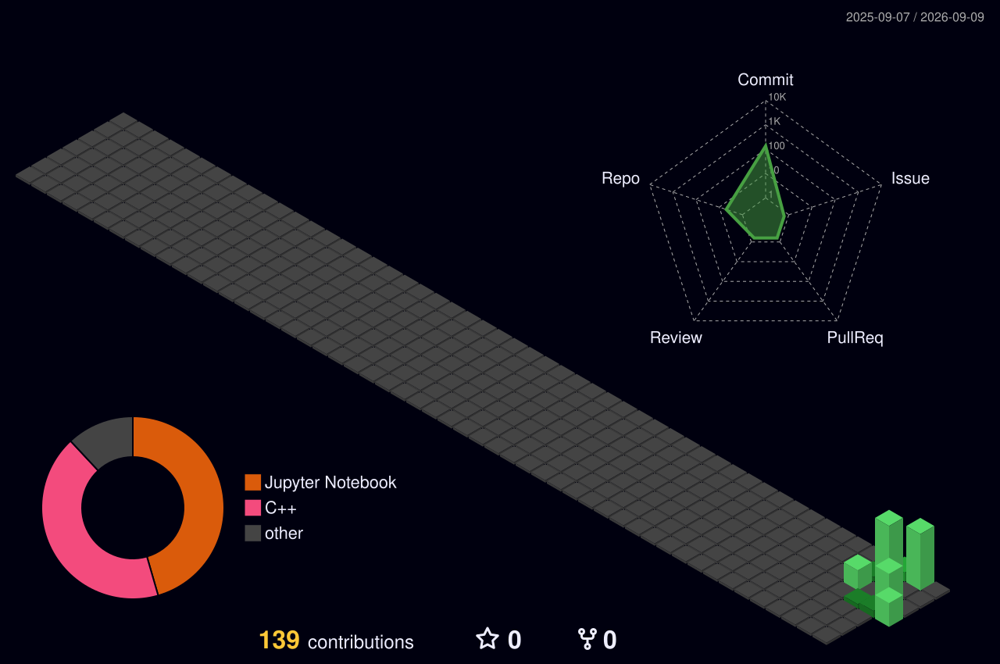

  

## About Me

Computer Science student at **Korea National Open University (KNOU)** interested in **Machine Learning Systems and AI Infrastructure**, with a focus on **GPU inference, model serving, batching, scheduling, and performance optimization**.

My projects connect model development, native C++ deployment, GPU profiling, and inference-serving experiments. I use measurements to identify bottlenecks, evaluate changes, and understand where an approach helps—and where it falls short.

---

## Research Interests

- Machine Learning Systems
- GPU Inference & Model Serving
- Batching & Scheduling
- Performance Optimization
- Distributed ML Systems
- Resource Management for AI Workloads

---

## Featured Projects

### GPU Inference Serving: Static, Adaptive & SLO-aware Batching

**Completed Experimental Study · C++17 · ONNX Runtime · CUDA**

Built a ResNet-50 inference-serving simulation to investigate how batching policies affect latency and throughput under different request workloads.

**Research Question**

> Under which request loads does each batching policy meet a latency target, and what does waiting to form a batch cost?

**Highlights**

- Implemented Static, Adaptive wait, Adaptive immediate, and SLO-aware batching with a thread-safe request queue
- Used 1,000 preprocessed ImageNet validation images with reproducible image ordering and planned arrival schedules
- Completed **84 performance runs** across low, medium, high, and bursty workloads, plus **21 separate GPU-monitored runs**
- At 250 requests/s, batching configurations sustained approximately **248–249 requests/s**, while Static batch 1 accumulated a backlog at approximately **189 requests/s**
- Observed workload-dependent trade-offs: immediate dispatch achieved low latency at light loads, while batching helped sustain higher request rates
- Found that SLO-aware scheduling did not consistently outperform simpler policies and missed its target at low load
- Diagnosed rising service time at low load and observed an association with GPU clock and performance-state changes; causality remains unconfirmed
- Published request-level metrics, charts, scheduler tests, reproduction instructions, and experimental limitations

[View Repository →](https://github.com/lucy980509/adaptive-batching-gpu-inference)

---

### GPU Inference Performance Analysis & Optimization

**ONNX Runtime · CUDA · NVIDIA Nsight Systems**

A performance study following a **baseline → profile → identify bottleneck → optimize → re-measure** workflow.

**Highlights**

- Evaluated FP32 and FP16 inference using ONNX Runtime's CUDA Execution Provider
- Investigated batch-size scaling and GPU execution behavior with NVIDIA Nsight Systems
- Identified disk I/O and image decoding as approximately **95.4% of Batch-64 end-to-end latency** in the tested pipeline
- Reduced measured Batch-64 latency from **11.236 ms to 0.359 ms** by preloading inputs into RAM
- Evaluated RAM caching and I/O Binding
- Examined why GPU-focused optimizations provided limited benefits for a small CNN

[View Repository →](https://github.com/lucy980509/wafer-defect-inference-cuda)

---

### C++ ONNX Runtime Inference Engine

**C++17 · OpenCV · ONNX Runtime · CMake**

A native inference pipeline for deploying a trained CNN **without a Python runtime dependency**.

**Highlights**

- Implemented image preprocessing and model inference in C++17
- Integrated OpenCV and ONNX Runtime
- Validated numerical consistency between Python and C++ inference
- Built an end-to-end inference application with CMake

[View Repository →](https://github.com/lucy980509/wafer-cpp-inference)

---

### Wafer Defect Classification Using CNN

**PyTorch · WM-811K · ONNX**

A deep learning pipeline for semiconductor wafer defect classification.

**Highlights**

- Developed a CNN using the WM-811K wafer map dataset
- Addressed class imbalance with weighted loss
- Evaluated train, validation, and test performance
- Used confusion matrices and error analysis to examine model behavior
- Exported the trained model to ONNX for downstream C++ deployment

[View Repository →](https://github.com/lucy980509/wafer-defect-classification)

---

## Certifications

### Certified Kubernetes Administrator (CKA)

- **Issued by:** The Linux Foundation
- **Issued:** October 2026
- **Credential ID:** LF-z2q5td53ev
- [Verify credential](https://www.credly.com/badges/6f2145aa-3fc0-4c2f-8cc5-8a2194bebabd/public_url)

---

## Technical Skills

### Languages

### Machine Learning & Data

### ML Deployment & Inference

### Systems & Performance

### Development Tools

---

## Current Research Focus

My recent projects examine how **input pipelines, batching policies, and runtime behavior** affect GPU inference performance.

Through profiling and controlled experiments, I have explored host-side bottlenecks, throughput–latency trade-offs, and the limitations of service-time estimates in deadline-aware scheduling.

I am interested in extending this work toward **efficient and scalable ML infrastructure**, particularly inference serving and resource management.

---

## Contact

---

## Contributions

  

